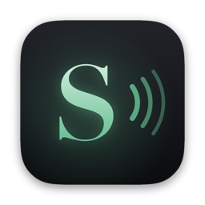
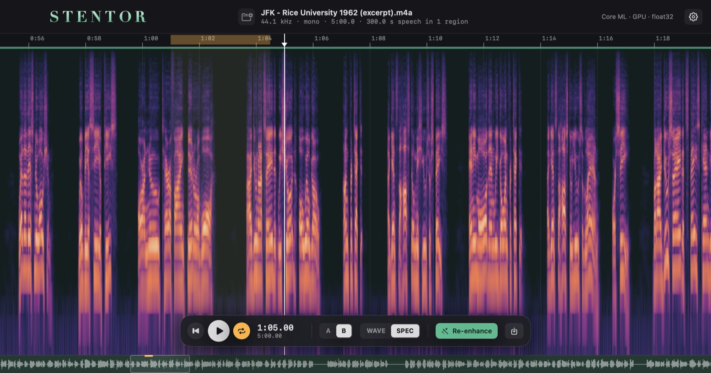
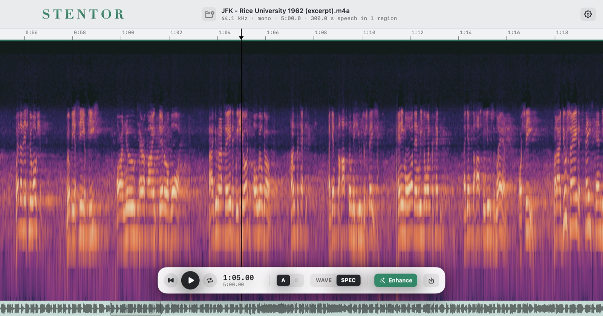
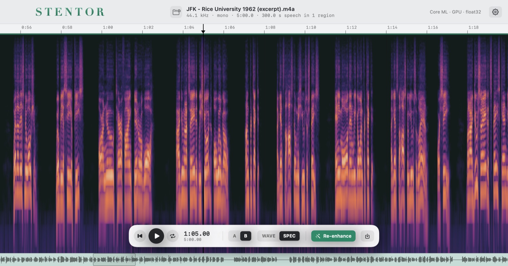

<p align="center"></p>

<h1 align="center">Stentor</h1>

<p align="center"><b>Studio-quality voice restoration for macOS, running entirely on your Mac.</b><br>
A native app built on <a href="https://github.com/sarulab-speech/Sidon">Sidon</a>, the open-source speech restoration model from the University of Tokyo.</p>

<p align="center"></p>

| Before (reverberant stadium recording) | After Stentor |
|---|---|
|  |  |

*Demo: J.F. Kennedy at Rice University, 1962 (public domain) — reverb, crowd and band-limiting removed.*

Named after [Stentor](https://en.wikipedia.org/wiki/Stentor), the herald of the Greeks in the *Iliad* whose voice was as loud as fifty men.

---

## Features

- **Restores speech** — removes noise, reverb and codec damage and rebuilds full 48 kHz bandwidth (Sidon: w2v-BERT 2.0 feature predictor + HiFi-GAN vocoder).
- **Only the voice is processed.** Speech is detected automatically and shown as green regions; everything else stays digital silence and the output keeps **exactly the original length**, so it lines up in your DAW.
- **Editable regions** — click to add, drag edges, hover the top of an edge for ✕, right-click to re-render, loop or delete a single region. After the first run only changed regions are processed again.
- **A/B comparison** with a level-matched original, waveform and spectrogram views, seamless looping, zoom and pan.
- **Fast and private** — Core ML on the Apple GPU, nothing leaves your computer. On an M1 (8 GB): ~3–5× real time, about 1 GB of memory.
- Dark / light / auto theme, detailed hover help, adjustable icon size, WAV export (16/24-bit, 32-bit float; 48 kHz or source rate).

## Download and install

**[⬇︎ Download the latest Stentor DMG](https://github.com/PaoloSani/speech-enhancer/releases/latest)** (≈ 900 MB — the voice model is included).

Requirements: Apple Silicon Mac (M1 or later), macOS 14 Sonoma or newer, ~2 GB free disk space.

1. Open `Stentor-0.1.0.dmg`.
2. Double-click **Install Stentor** and follow the steps: Welcome → License → Destination → Install (your Mac password is needed to write to Applications) → Summary.
3. Open **Stentor** from Applications. A public-domain demo recording opens on first launch.

> **"Install Stentor can't be opened"?** Current builds are not yet signed with an Apple Developer ID.
> Right-click the installer and choose **Open**, or go to **System Settings › Privacy & Security** and click **Open Anyway**.

The first launch prepares the model for your GPU (about 10 s, once).

## Using Stentor

1. **Open** a recording — drop it on the window, press `⌘O`, or click the file name in the header.
2. **Check the green regions.** Only these are restored; tune detection in Settings (gear, top right) if needed.
3. **Enhance** (`⌘↩`), then press `B` to compare with the original.
4. **Export** (`⌘E`).

| Action | How |
|---|---|
| Add a region | click empty space (up to the next region) or drag to draw one |
| Adjust / remove | drag a green edge · hover its top and click ✕ · `⌘`-click · select + `Delete` |
| Region menu | right-click: enhance only this region, loop, play, delete |
| Seek / loop | click the ruler · drag on it to set a loop · `L` toggles loop (defaults to the first region) |
| Navigate | scroll ↕ or pinch = zoom at pointer · scroll ↔ = pan · overview strip at the bottom |
| Listen | `Space` play/pause · `B` original ↔ enhanced · `S` waveform ↔ spectrogram |
| Edit history | `⌘Z` / `⇧⌘Z` |

Hover anything for a detailed explanation (Settings › Help › Detailed tooltips).

## Build from source

Everything builds with the Xcode **Command Line Tools** — full Xcode is not required.

```bash
# 1. Python environment (Apple Silicon)
/opt/homebrew/bin/python3.12 -m venv .venv
.venv/bin/pip install -r requirements-mac.txt

# 2. Sidon weights (TorchScript release, MIT) — sidon_weights/ is tracked with Git LFS,
#    or download feature_extractor_cpu.pt and decoder_cpu.pt from
#    https://huggingface.co/sarulab-speech/sidon-v0.1 into sidon_weights/
git lfs pull

# 3. TorchScript -> eager PyTorch -> Core ML (about 2 minutes, ~2 GB, git-ignored)
.venv/bin/python tools/convert_torchscript.py
.venv/bin/python tools/export_coreml.py

# 4. The app
cd mac-app
./build_app.sh                 # build/Stentor.app (reads models from ../sidon_weights/coreml)
./package.sh                   # build/Stentor-0.1.0.dmg with the guided installer and bundled models
```

Publishing a release (maintainers): `gh release create v0.1.0 mac-app/build/Stentor-0.1.0.dmg --title "Stentor 0.1.0"`.
To ship signed builds, set `SIGN_APP` / `SIGN_PKG` to your Developer ID identities when running `package.sh`, then notarize the DMG (`xcrun notarytool submit … --wait` and `xcrun stapler staple`). Details in [mac-app/README.md](mac-app/README.md).

## How it works

1. **Load** any format (WAV, AIFF, FLAC, MP3, M4A…), mix to mono, resample to 16 kHz, 50 Hz high-pass, peak-normalise.
2. **Detect speech** and turn it into editable regions.
3. **Restore each region**: Kaldi fbank features → w2v-BERT 2.0 feature predictor (Sidon, 8 layers + LoRA) → HiFi-GAN vocoder at 48 kHz. Long regions are split at the quietest point and joined with crossfades; every model call uses one of two fixed lengths so GPU memory stays flat.
4. **Assemble** a full-length 48 kHz file: restored regions with short fades, silence elsewhere.

The released Sidon TorchScript graphs only run on CPU. `tools/convert_torchscript.py` transcribes them into bit-exact eager PyTorch modules (no network, no `transformers`), and `tools/export_coreml.py` exports Core ML packages that run on the GPU. The Swift engine is validated against the Python reference (features within 3·10⁻⁴, audio at 81 dB SNR).

## Python engine

The `speech_enhancer` package is the reference implementation and a command-line tool.

```bash
.venv/bin/python -m speech_enhancer segment recording.m4a      # VAD -> editable recording.segments.json
.venv/bin/python -m speech_enhancer enhance recording.m4a      # -> recording_enhanced.wav (speech regions only)
.venv/bin/python -m speech_enhancer enhance recording.m4a --mode full --backend coreml --precision float16
.venv/bin/python -m speech_enhancer gui                        # local web GUI at http://127.0.0.1:8765
```

| Backend (M1, 8 GB, 5-min file) | Speed | Peak memory | Fidelity |
|---|---|---|---|
| TorchScript, CPU | 1.6–1.8× real time | 5.1 GB | reference |
| Core ML float32, GPU | 4.2× real time | 1.8 GB | identical (>84 dB SNR) |
| Core ML float16, GPU | 5.2× real time | 1.2 GB | ~28 dB SNR |

The Neural Engine is not used: its fp16 arithmetic audibly degrades the vocoder.

### Batch processing on NVIDIA GPUs (Linux)

`enhance_folder.py` and `processor.py` enhance whole folders with the CUDA TorchScript weights
(`--device`, `--chunk-seconds`, `--num-workers`, `--batch-size`, `--skip-errors`, `--force`; output goes to a sibling
`audio_48kHz_enh` folder). Environment: Python 3.12 with `torch==2.8.0+cu128` installed first, then
`uv pip install -r sidon_requirements.txt --no-build-isolation` (needs a CUDA 12.8 driver).
Note: `sidon_weights/feature_extractor_cuda.pt` in this repository is truncated — re-download it from Hugging Face.

## Repository layout

```
mac-app/              Stentor, the native macOS app (SwiftUI + Core ML)
  Sources/Stentor/    Engine/ (fbank, Core ML model, regions, audio I/O) and UI/
  Installer/          guided installer pages, license and artwork
  Resources/          app icon and the public-domain demo recording
speech_enhancer/      Python reference engine, CLI and web GUI
tools/                TorchScript -> eager PyTorch -> Core ML conversion
sidon_weights/        Sidon TorchScript weights (Git LFS); generated eager/ and coreml/ are git-ignored
docs/                 images for this README
processor.py, enhance_folder.py   original CUDA batch scripts
```

## Roadmap

- Native builds for Windows and Linux (ONNX Runtime: DirectML / CUDA / CPU).
- Neural voice activity detection (Silero) for noisy or reverberant material.
- Signed and notarized releases.

## Credits and licenses

- **Stentor** — built by Paolo Sani. MIT License (see [LICENSE](LICENSE)).
- **Sidon** — W. Nakata, Y. Saito, Y. Ueda, H. Saruwatari, The University of Tokyo ([paper](https://arxiv.org/abs/2509.17052), [code](https://github.com/sarulab-speech/Sidon), [weights](https://huggingface.co/sarulab-speech/sidon-v0.1)). MIT License.
- **w2v-BERT 2.0** — Meta AI ([model](https://huggingface.co/facebook/w2v-bert-2.0)). MIT License.
- **Demo recording** — John F. Kennedy, address at Rice University, 12 September 1962. John F. Kennedy Presidential Library and Museum, via [Wikimedia Commons](https://commons.wikimedia.org/wiki/File:Jfk_rice_university_we_choose_to_go_to_the_moon.ogg). Public domain.
